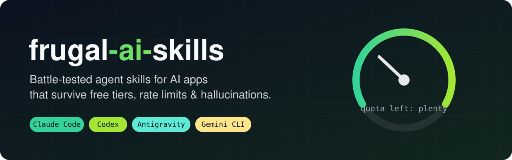

<p align="center">
  
</p>

<p align="center">
  <b>Your AI agent writes code fast. These skills make it write code that survives production on a $0 budget.</b>
</p>

<p align="center">
  
  
  
  
</p>

<p align="center">
  <a href="#-install-in-30-seconds">Install</a> ·
  <a href="#-the-skills">Skills</a> ·
  <a href="#-how-it-works">How it works</a> ·
  <a href="#-bahasa-indonesia">Bahasa Indonesia</a>
</p>

---

## 🤔 Why this exists

Ask any coding agent to "add an AI feature" and you'll usually get something that works
in a demo, then breaks in production:

- 💸 **The free LLM key dies by noon.** One key does all the work while nine more sit unused.
- 🧟 **A `fetch` hangs forever** and burns the whole serverless function budget.
- 🤖 **A scanner drains your Redis quota.** It never gets in. It just makes you pay to reject it 5,000 times.
- 🎲 **The AI makes up a number.** It looks exactly as confident as the real ones, and it ships.
- 🔁 **A cron job runs twice, or never**, because the platform gives you two cron slots.

Every skill here comes from a real production app (multi-agent market analysis,
auto-publishing to social, AI video reels) that has to **run on free tiers**. These are
the fixes that lasted, written as instructions any agent can follow.

## ⚡ Install in 30 seconds

```bash
git clone https://github.com/960nata/frugal-ai-skills.git
cd frugal-ai-skills && ./install.sh
```

That's it. The installer finds which agents you have and symlinks the skills in, so a
`git pull` later updates them all.

<details>
<summary><b>More install options</b></summary>

```bash
./install.sh claude codex          # only these agents
./install.sh all                   # every supported agent
./install.sh --copy all            # copy instead of symlink
./install.sh --project ./my-app    # install into one repo (commit it for your team)
```

| Agent | Global | Per project |
| ----- | ------ | ----------- |
| Claude Code | `~/.claude/skills/` | `.claude/skills/` |
| OpenAI Codex (GPT) | `~/.codex/skills/` | `.agents/skills/` |
| Google Antigravity | `~/.gemini/antigravity/skills/` | `.agent/skills/` |
| Gemini CLI | `~/.gemini/skills/` | `.gemini/skills/` |

Skill folders sometimes move between agent releases. If a skill doesn't appear, check
your agent's docs and symlink `skills/<name>` into the new location.

**Claude.ai / ChatGPT web:** zip one skill folder and upload it where your plan supports
custom skills, or paste its `SKILL.md` into a project's instructions.
**Any other agent:** point it at [`AGENTS.md`](AGENTS.md).
</details>

## 🧰 The skills

### 🔑 Survive the quota

| Skill | The problem | What your agent does instead |
| ----- | ----------- | ---------------------------- |
| [**llm-key-rotation**](skills/llm-key-rotation/SKILL.md) | 10 free keys, but key #1 takes every hit | Spreads load from a random start key, cools down keys based on *why* they failed (60 s / until the daily reset / 24 h), falls back to the next provider, and never logs a full key |
| [**layered-api-shield**](skills/layered-api-shield/SKILL.md) | Bots spend your KV quota just to be rejected | Runs checks cheapest first: a 0-command pattern shield, a remembered blocklist, then a rate limit in **1 Redis EVAL instead of 3 commands**, plus a global daily AI budget |
| [**fetch-timeout-guard**](skills/fetch-timeout-guard/SKILL.md) | One hung API call eats a 300 s function | Routes every outbound call through one wrapper with a timeout, caller-cancel support, and an error that names who didn't answer |

### 🧠 Keep the AI honest

| Skill | The problem | What your agent does instead |
| ----- | ----------- | ---------------------------- |
| [**llm-fact-guard**](skills/llm-fact-guard/SKILL.md) | Hallucinated numbers look exactly like real ones | Checks every number against the source (works with `1.234` and `1,234` formats and rounding), blocks banned phrases, then asks a second model that is **only allowed to lower confidence** |
| [**multi-agent-council**](skills/multi-agent-council/SKILL.md) | Four agents end up repeating the first one, mistakes included | Gives every agent the same facts, adds an independence rule (`AGREE: <evidence>` / `CORRECTION: …`), refuses to run on stale data, and saves each turn so a timeout resumes instead of paying again |
| [**persona-voice-prompt**](skills/persona-voice-prompt/SKILL.md) | "Make it casual" quietly breaks the accuracy rules | Puts the brand voice in one shared module (with an Indonesian Gen Z example) and keeps fact rules out of its reach |

### ⚙️ Ship on serverless

| Skill | The problem | What your agent does instead |
| ----- | ----------- | ---------------------------- |
| [**serverless-cron-dispatcher**](skills/serverless-cron-dispatcher/SKILL.md) | The platform gives you 2 cron slots and you need 20 jobs | Runs one hourly dispatcher over a schedule table with timezone and trading-day rules, and claims each batch with a single SQL `ON CONFLICT` lease so no job runs twice |
| [**html-allowlist-sanitizer**](skills/html-allowlist-sanitizer/SKILL.md) | AI-written HTML → `dangerouslySetInnerHTML` → stored XSS | Uses an allowlist (not a blocklist) as a pure function that runs on server and browser, and ships with 9 attack payloads to test against |

### 🎬 Create content

| Skill | The problem | What your agent does instead |
| ----- | ----------- | ---------------------------- |
| [**audio-lipsync-frames**](skills/audio-lipsync-frames/SKILL.md) | Phoneme lip-sync is heavy and glitchy | Drives 3 mouth shapes from voice loudness, smooths at 10 Hz, closes the mouth on pauses, and estimates timing for silent previews. Built for Remotion |
| [**social-autopost-pipeline**](skills/social-autopost-pipeline/SKILL.md) | Graph API rules you only learn by failing | Covers Threads (500 chars, 1 tag) and Instagram carousels (public JPEGs, container polling), with post-once dedupe, 60-day token refresh, and a content-mix schedule |

## 🔍 How it works

```
 you: "my gemini keys keep hitting 429"
          │
          ▼
 agent reads every skill's description ──► match: llm-key-rotation
          │
          ▼
 loads SKILL.md ──► steps + reference code + checklist
          │
          ▼
 writes code that fits your stack, then goes through the checklist ✅
```

You never call a skill by hand. Just describe the problem:

> *"Add rate limiting, Upstash keeps running out"* → `layered-api-shield`
> *"The AI summary invents numbers"* → `llm-fact-guard`
> *"Make my mascot talk in the Remotion video"* → `audio-lipsync-frames`

Each `SKILL.md` stays under ~150 lines so it doesn't fill the agent's context. Every
skill has a **why** (so the agent doesn't "simplify" away the important part), **steps**,
**reference code** written to be adapted rather than pasted, and a **checklist**.

## 🤝 Contributing

Got a pattern that stopped a production fire? Add it.

1. Create `skills/<kebab-name>/SKILL.md`, with the folder name matching `name:` in the frontmatter.
2. Write a `description` that says **what it does + when to use it**. Agents match on these words.
3. Keep it under ~150 lines and move long material to `references/`.
4. Leave out secrets, account IDs, and company names. Run `./scripts/validate.sh`.

## 🇮🇩 Bahasa Indonesia

**frugal-ai-skills** adalah kumpulan *skill* untuk agent AI (Claude Code, Codex/GPT,
Antigravity, Gemini CLI) supaya kode AI yang ditulis agent **hemat kuota, aman, dan
nggak gampang tumbang** di tier gratis atau serverless.

Semua diambil dari aplikasi yang beneran jalan di production, bukan teori:
- rotasi banyak API key
- rate limit yang cuma pakai 1 perintah Redis
- pengecek angka karangan AI
- komite multi-agent yang independen
- cron hemat slot
- sanitasi HTML
- lip-sync karakter
- auto-post Threads dan IG

**Cara pakai:** `./install.sh`, terus ngobrol ke agent seperti biasa. Skill otomatis
dipakai kalau masalahnya cocok.

## 📄 License

MIT. Pakai, ubah, dan jual sesuka kamu. Kasih ⭐ kalau ada skill yang menyelamatkan kuota kamu.
